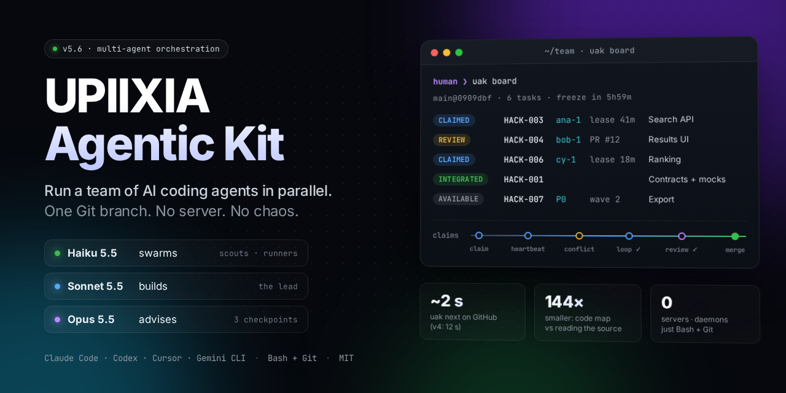
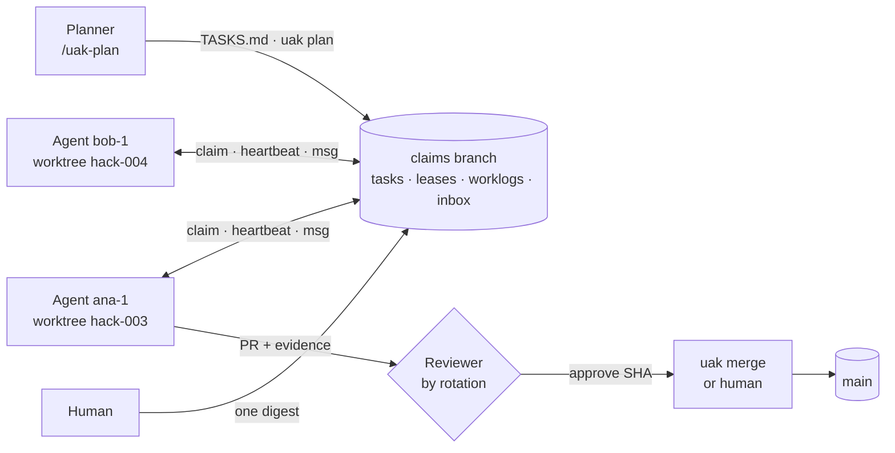
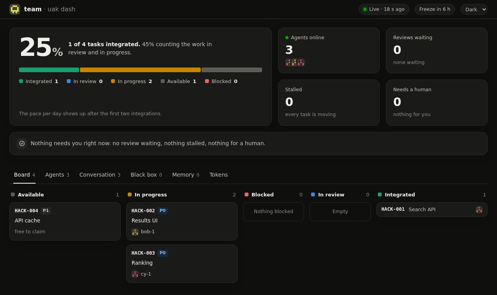

<div align="center">



# UPIIXIA Agentic Kit

### Ship with a team of AI coding agents, in parallel, without chaos.

**Multi-agent coordination for Claude Code, Codex, Cursor and Gemini CLI.** Agents claim tasks, run bounded verify → fix loops, review each other and merge. It works across several humans and machines, with **no server**: just a Git branch and Bash.

**`sprint`** mode wins hackathons · **`marathon`** mode ships secure, scalable products

[](https://github.com/JoahanMorales/upiixia-agentic-kit/actions/workflows/test.yml)


[](https://m8ven.ai/mcp/joahanmorales-upiixia-agentic-kit-1e9007?s=readme)

[Quick start](#quick-start) · [First claim](#stuck-before-the-first-claim-uak-start) · [Why](#why) · [Orchestration](#subagent-orchestration-fast-swarms-a-balanced-lead-a-strong-advisor) · [Pacing](#plan-pacing-spend-the-5-hour-window-dont-hit-the-wall) · [Black box](#black-box-the-kit-learns-from-every-team-that-uses-it) · [Frontend](#frontends-that-dont-look-generated) · [Deploy](#deploy-in-one-command-uak-deploy) · [Dashboard](#see-everything-uak-dash) · [Modes](#two-modes-one-engine) · [Loop engineering](#loop-engineering) · [Graph engineering](#graph-engineering) · [Speed](#speed) · [Token economy](#token-economy) · [Results](#battle-tested-six-team-runs) · [Contributing](CONTRIBUTING.md)

</div>

---

## Try it in 30 seconds (no setup, no API key)



```bash
git clone --depth 1 https://github.com/JoahanMorales/upiixia-agentic-kit && bash upiixia-agentic-kit/kit/.uak/bin/uak demo
```
It runs a real 3-agent session in a temp repo with a local Git remote:
- `uak start` at minute 0: every step to the first claim checked, then the command that starts;
- parallel claims, and an overlapping claim rejected, with `uak next` saying why it offers nothing;
- a bounded fix loop (`LOOP_FAIL → LOOP_FAIL → LOOP_PASS`);
- a review of the exact SHA by another agent, then a gated merge;
- a dependent task unlocking by itself;
- the team board.

## Quick start

Going to a hackathon? The one-page plan is in **[docs/HACKATHON.md](docs/HACKATHON.md)**. You pick the mode yourself at install. There is no default: `sprint` for a deadline with judges, `marathon` for a product with users after launch.


**1. Install into any Git repo** (30 s; needs Bash 3.2+ and Git):

```bash
git clone --depth 1 https://github.com/JoahanMorales/upiixia-agentic-kit ~/.uak-kit
bash ~/.uak-kit/install.sh --mode sprint .          # hackathon / AI prototype
# or: --mode marathon                               # real product: specs, CODEOWNERS, security reviews
# options: --stack fastapi-react|nextjs|django|go|expo|python-data|ai-agent|spring-boot   --skills ai,tdd   --update (refresh the engine later)
#          --harness claude,codex (only the dirs of the tools you use)   --no-mcp (CLI only)   --no-blackbox
#          --solo (alone on the GitHub repo: agents review each other on claims; in marathon you still merge)
bash .uak/bin/uak start                              # every step to the first claim, in order, then the command that starts
```

It never overwrites your files: a kit file you edited gets its new text beside it as `.uak-new`; an older kit file nobody touched is simply updated by `--update`. Your hook manager (husky, lefthook) keeps its `core.hooksPath`.

**Or, in Claude Code:**

```
/plugin marketplace add JoahanMorales/upiixia-agentic-kit
/plugin install uak@upiixia-agentic-kit
/uak:setup
```

**2. Plan:** open your agent in the repo and run `/uak-setup`, then `/uak-plan`. Codex, Cursor and Gemini read `AGENTS.md` natively. Then `bash .uak/bin/uak start` until it says `START READY`.

**3. Start the team:**

```bash
bash .uak/bin/uak up 4 --tmux                 # claim the 4 best tasks, one worktree + agent each (tmux)
# or one agent at a time:
bash .uak/bin/wt new HACK-003 --agent ana-1   # branch + worktree + identity + port + claim
bash .uak/bin/uak board --watch 10            # live team kanban for the humans
```

**4. Deploy the walking skeleton early:** `bash .uak/bin/uak deploy --write` writes the Dockerfile and a Render Blueprint for your stack (Vercel for Next.js). Connect the repo once; every merge redeploys.

That's it. `uak next` always tells every agent what to do next.

### Stuck before the first claim? `uak start`

The first claim needs a few things: the kit pushed to `main` (agents read `main`'s copy, not yours), an approved
plan, a reviewer who is not the author. Missing any one of them used to look the same: "No eligible candidate".
`uak start` checks them in order and names the one fix for each:

```text
$ bash .uak/bin/uak start
OK    1. kit installed (marathon, uak 5.3.0)
OK    2. remote origin reachable
OK    3. preflight: doctor has no failures (4 warning(s): bash .uak/bin/doctor)
OK    4. .uak/ on origin/main matches this checkout (uak 5.3.0)
OK    5. plan: 1 task(s), lint clean
TODO  6. approve the plan: Backlog-Approved is not yes on main, so nothing can be claimed for 10 min and then only P0
         you are the human: read .uak/TASKS.md, set Backlog-Approved: yes in .uak/PROJECT.md, push it to main
NOTE  reviews: no reviewer is registered, so the first PR waits until a second agent holds a claim. Working alone? …

START · 1 thing to do before the first claim. Then run uak start again.
```
When everything is in place, it prints `START READY · bash .uak/bin/wt new APP-001`. `--fix` does the mechanical
fixes (hooks; `Review-Mode: claims` when gh says you are the repo's only collaborator). An agent gets the same
answer from `uak next`: with nothing to offer, it says why for each task.

```text
Why not APP-001: Backlog pending approval: Backlog-Approved is not yes in .uak/PROJECT.md on main, so only P0 tasks,
and only after 10 min (10 min left). The human approves the plan: set Backlog-Approved: yes there and push it to main.
```

**Alone on the repo?** Install with `--solo`. GitHub never lets a PR's author approve it, so in `--solo` mode agent
identities review each other on the claims branch, and you still merge.

## Why

One agent in one terminal is easy. **Five agents run by four people on three machines** is chaos:

- two agents edit the same file;
- one runs out of tokens while holding the task everyone waits on;
- a force-push wipes a teammate's work;
- the human becomes a traffic light for every merge.

This kit is the protocol we used to ship **76 PRs in ~14 hours with 5 agents and 4 humans** at Hack-Nation 2026, rebuilt from a data-driven post-mortem of everything that went wrong ([retro](docs/RETRO-hacknation-2026.md)).

| Without the kit | With the kit |
|---|---|
| "Who's on the login page?" | `uak next`: one eligible task per agent, with path overlap rejected at claim time |
| An agent dies and its work is stranded | Leases + a 6-line live summary: the next agent resumes from the exact next step |
| Agents loop forever on a failing test | Bounded loops: 5 attempts, stuck detection, then escalate with the exact error |
| `cd x && git push --force` | Blocked by a hook, even when chained |
| An API key pasted into the chat | Blocked before the model ever sees it |
| The human merges 75 PRs by hand | Reviewer rotation + an auto-merge queue that re-runs every gate (sprint) |
| "Did anyone check that it works?" | Every PR has a reviewer who is not the author and who **runs** Verify on the exact SHA |

## Two modes, one engine

| | `sprint` (hackathon, AI prototype) | `marathon` (real product) |
|---|---|---|
| Optimizes | demo wow per hour, a stunning frontend | correctness, security, scale |
| Planning | IDEA → rubric → vertical P0 tasks | constitution → spec (EARS) → plan + threat model → tasks |
| Backlog changes | `uak plan` publishes instantly (no PR) | reviewed PR |
| Merge | auto-merge after review and green gates | human CODEOWNERS + required CI; agents pre-review |
| Frontend | design lock at T+1h, `design-critic` on 1280×720 screenshots | perf budgets, accessibility in CI |
| Safety net | mandatory freeze scaled to the event (`uak clock`), plan-B video, human owns submission | `security-reviewer`, dependency decisions, ADRs, TDD |
| Lease / review wait | 45 min / 4 h | 4 h / 24 h |

The mode is one line, `Mode:` in `.uak/PROJECT.md`. Rules: [`AGENTS.md`](kit/AGENTS.md) · [sprint](kit/.uak/modes/sprint.md) · [marathon](kit/.uak/modes/marathon.md).

## How it works



- **The `claims` branch is the database.** Every state change is a commit pushed fast-forward. Races resolve like Git does: fetch, rebase, re-validate, retry. It works across machines, people and tools.
- **Path reservations.** Tasks declare `Paths`. Overlapping claims are rejected, and shared files (lockfiles, schemas, CI) need an owner.
- **Typed async inbox.** `contract`, `request`, `review`, `approve`, `reject`. Hooks inject only the actionable messages into the agent's context.
- **Guards.** A `PreToolUse` hook blocks destructive Git, `sudo`, `.env` reads and publishing. A `UserPromptSubmit` hook blocks pasted secrets.

## Subagent orchestration: fast swarms, a balanced lead, a strong advisor

The best result per token, in **every** harness. The strongest model wakes up only where judgment changes the outcome ([ORCHESTRATION.md](kit/.uak/docs/ORCHESTRATION.md)).

| Tier | Claude Code | Codex | Cursor | Gemini CLI | Job |
|---|---|---|---|---|---|
| **fast** swarm | Haiku 5.5 | GPT-6 Luna | Composer 2.5 | Gemini 3 Flash | scouts and runners: find, read, run noisy commands, return ≤15 lines, up to 3 in parallel |
| **balanced** lead | Sonnet 5.5 | GPT-6.1 Sol | your model | your model | plans, edits, runs Verify, decides; reviews |
| **strong** advisor | Opus 5.5 | GPT-6 Astra | Opus 5.5 | Gemini 3 Pro | only at **plan lock**, **the same failure twice**, and **done** on risky diffs |

On the GPT-5.6 family, Sol is strong, Terra balanced and Luna fast. The guard knows both families.

- **The same 6 subagents everywhere.** `.claude/agents`, `.codex/agents`, `.cursor/agents` and `.gemini/agents` are generated from one source (`scripts/gen_harness.py`) and checked in CI.
- **Configured for you:**
  - Claude: `model: sonnet`, `advisorModel: opus`, `CLAUDE_CODE_SUBAGENT_MODEL=haiku`, spawn depth 1.
  - Codex: `model = "gpt-6.1-sol"`, `default_subagent_model = "gpt-6-luna"`, `max_concurrent_threads_per_session`.
- **Enforced, not just suggested:** `guard agent` (Claude Code, Codex and Cursor hooks) caps parallel subagents and **strong subagents per session**, even under ultracode. `UAK_ALLOW_OPUS=1` is the human override.
- **No advisor tool or a long session:** `/uak-advise plan|stuck|done` sends a ≤40-line packet instead of replaying the transcript.
- **Verified live:** a real headless run used `claude-sonnet-5-5` as lead and `claude-haiku-5-5` as scout, for 0.085 USD in total.
- We checked the viral claims against the docs. `/advisor` is real; `--subagents`, "dispatcher pools" and "JEV 16 ms" are not ([details](kit/.uak/docs/ORCHESTRATION.md#what-we-did-not-adopt-claims-that-circulate-online)).

## Plan pacing: spend the 5-hour window, don't hit the wall

`uak pace` compares **budget left** with **time left** in each usage window and turns it into a level the guard enforces ([COSTS.md](kit/.uak/docs/COSTS.md)).

```bash
bash .uak/bin/uak pace
# PACE surge | claude-5h 30% used, resets in 1h0m, ratio 3.50 | caps: parallel 8, strong 4 | spend: budget will expire unused…
```

| Situation | Ratio | Level | What changes |
|---|---|---|---|
| 1 h left of 5 h, 70% of the plan left | 3.5 | **surge** | 2× parallel subagents, +2 strong, `uak up 2` |
| on track | 1.0–1.6 | normal | default routing |
| 3 h left, 50% left | 0.83 | **conserve** | ½ parallel, 1 strong, fast tier for every read |
| ≥ 90% used, or ratio < 0.6 | — | **critical** | 1 subagent, no strong model, checkpoint and hand off before the limit |

- **Hard limits above pacing.** Fixed numbers that pacing can lower but never raise: in sprint, 6 parallel, 3 strong, 40 spawns per session, 8 per machine, 6 per minute, and 6 agents per `uak up`. A wrong reading can't burn your plan in minutes. Surge also needs fresh data.
- **Where the numbers come from:**
  - Claude Code: the status line's `rate_limits` (Pro/Max).
  - Codex: `rate_limits` in `~/.codex/sessions`.
  - Cursor or any dashboard: `uak pace set 60 --resets +12d --window 30d`.
- **COSTS.md** also has the price tables (Haiku is 1×, Sonnet 20×, Opus 40× per token; Luna 1×, Sol 20×, Astra 100×) and the Pro, Max, Plus and Ultra limits. It suggests starting caps per plan.

## Black box: the kit learns from every team that uses it

Like a flight recorder: **every `uak` error and guard block is recorded automatically**, and agents add one line when the kit slows them down (`uak bb add friction "…" --fix "…"`). Lines are anonymous: no identities, paths, SHAs or code, and anything that looks like a secret is dropped. They go to `claims:blackbox/`. `scripts/blackbox_harvest.py` finds public repos that use the kit, reads their `claims:blackbox/` and ranks what to fix next (`uak bb export` also writes a readable `.uak/BLACKBOX.md`).

**On by default; off with `Blackbox: off`** in `.uak/PROJECT.md`, or `install.sh --no-blackbox` ([BLACKBOX.md](kit/.uak/docs/BLACKBOX.md)). The [first harvest](docs/blackbox/upiixsol-2026-10.md) came from a 3-day, 2-human marathon project. Every row became a v4.1 fix. The [Reap buildathon autopsy](docs/blackbox/reap-2026-10.md) (4 h, 5 humans, 11 agents on Codex, Cursor and Claude Code) became v4.2. The [MLB hackathon autopsy](docs/blackbox/mlb-2026-10.md) (10 days, 4 humans on Windows, 13 identities on Claude Code, Codex and Cursor) became v4.3, shipped in v5.

## Loop engineering

Every loop declares a **trigger, a verifier, a budget, a stop condition and an escalation**, or it isn't allowed ([LOOPS.md](kit/.uak/docs/LOOPS.md)).

```bash
# An unattended, bounded fix loop. Works with any CLI agent that reads a prompt on stdin.
bash .uak/bin/uak loop --verify "uv run pytest -q" --agent "claude -p --permission-mode acceptEdits" --max 5 --task HACK-007
# LOOP_FAIL iteration=1 exit=1 · test_api.py::test_search FAILED
# LOOP_PASS iteration=2 · 12 passed in 1.9s
# Many failing files: one small loop per file, in parallel worktrees, fixes applied back
bash .uak/bin/uak loop --verify "uv run pytest -q" --parallel 3 --each "uv run pytest -q {}" --agent "codex exec -"
```
- **Guards, not promises:** the loop stops when the agent changes nothing, or when it edits an existing test (the verifier).

- **Inner loop** (`/uak-loop`): implement → `q verify` → fix; 5 tries; the same error twice → BLOCKED with that error.
- **Hook loops:** a heartbeat every lease/3 and a claims check every 20 s (inbox read only when it moved), in the background; `uak wait` instead of polling.
- **Review loop:** `done` → an online reviewer by rotation → approve or reject → merge queue. An offer nobody starts in 15 min moves to another agent, then to all: nothing waits on a closed session.
- **Deadline loop:** decisions resolve after 15 min (routine only), backlog P0s after 10 min, freeze on schedule.
- Failures are fed back as a 40-line tail, never full logs. Agent output goes to a log file, never into your context.

## Graph engineering

A team of agents is a graph: **members, mandates, message paths, shared state, routing, traceability**. Every edge here is a file or a command ([GRAPH.md](kit/.uak/docs/GRAPH.md)).

```bash
bash .uak/bin/uak graph --min-wave1 4
# GRAPH 9 tasks · 3 waves · critical path 135 min: HACK-002 → HACK-006 → HACK-009
# wave 1 (5): HACK-001 HACK-002 HACK-003 HACK-004 HACK-005
bash .uak/bin/uak graph --mermaid      # live state colors, paste into any PR or issue
bash .uak/bin/uak graph --assign       # ready task → idle agent that already integrated work in those folders
```

**The code graph (`uak map`)**, graphify-style with two layers: EXTRACTED edges (symbols, resolved imports and call
edges, by Bash + awk: free, offline, rebuilt on every change) and optional INFERRED ones (`uak map notes`: the fast
model gives the key files a purpose and concepts once, cached by content hash). An agent reads a compact `MAP.md`
instead of opening files. Measured on a 123-file analytics repo: the whole source is ~187k tokens, `MAP.md` ~1.3k, and "where is
`data_path` defined and who uses its module" costs ~280 tokens from the map vs ~3.1k opening the files.
```bash
bash .uak/bin/uak map find data_path · map users core/config.py · map path A B · map impact HACK-001
bash .uak/bin/uak msg impact:HACK-001 --kind contract "data_path takes a Path now"   # every task whose files import it
```

**Memory anchored to paths**: `uak learn "what bites · where · what to do"` stores a lesson on the task's paths;
`uak next`, which every session starts with, shows the newest lessons to whoever works there next. A reviewer's
reject note becomes one with `--learn`. The claim also brings back past work by words: the rejects, contracts
and lessons of similar tasks with other paths, ranked by BM25 (`uak recall ID --similar`; no model, no network).

`uak lint` fails on dependency cycles and unknown IDs. `Uses contract:` edges let consumers work on mocks instead of waiting.

## The harness is used when it matters

Good tools are useless if the agent does not know when to reach for them. Rules in `AGENTS.md` are in context, but
attention fades over a session. v5 puts the right command at the moment of decision: a quick card at session start
(when X → run Y), capped reminders after tool calls (5 reads in a row → the code map; polling → `uak wait`; a push
that touches files another task imports → `msg impact:`), and the next step printed by every command.

Measured, not assumed ([adoption eval](docs/evals/README.md), real headless Claude Code sessions): with the rule in
context, the agent warned the task that imports its change in **0 of 3** runs; with the adoption layer, **3 of 3**.

**The graph comes to the agent (v5.2).** Reminders were not enough for the code map: at MLB agents called it 9 times
for 67 Claude Code tasks, and a pilot study saw agents route 0–6% of lookups to a semantic tool when grep was there.
So the map is pushed into the loop instead of waiting to be asked. The claim prints the task's slice of the map
(its files, what they define, who imports them, which tasks to warn), and after a `grep`/`Read` the post-tool hook adds one line:
`uak map: data_path is defined at lib/config.py:1; called from 3 places in 2 other files: …`, or
`uak map: lib/config.py · imported by 12 files · not in HACK-007's Paths: the merge gate refuses edits here`.
Claude Code, Codex, Cursor and Gemini CLI, each symbol or file once per session. `uak stats` reports adoption per
harness (map calls and pushed lines per task, `wait` and polls per done), with the hooks' own calls counted apart.

**MCP server.** The same harness is also a native MCP server (`.uak/bin/uak-mcp`, Python standard library): 14 tools
(`uak_next`, `uak_claim`, `uak_ship`, `uak_wait`, `uak_map`, `uak_memory`, …), resources (the code map, team status,
lessons) and the `/uak-*` workflows as prompts, for Claude Code, Codex, Cursor and Gemini CLI. It speaks both MCP
2026-07-28 (stateless) and 2025-11-25 (handshake), and every tool runs the same CLI and gates.
**MCP or Bash: your choice, per team or per agent.** Both stay available and share the same state: an agent can
claim through `uak_claim` and ship through `bash .uak/bin/uak done`. Don't want the server? Decline it when Claude
Code asks, or install with `--no-mcp` (no `.mcp.json`, `.cursor/mcp.json`, nor the uak blocks in Codex and Gemini
configs). In the eval, agents with both chose Bash and did as well; MCP matters most in clients without a shell.

## Frontends that don't look generated

We won first place at Chilangatón and nearly lost it on the UI. The first version was a column of white boxes with gray
borders, raw `stone-*` classes and every label in the same weight, and it was redone from scratch 3 hours in. The
autopsy found four causes, and v5.4 closes each one:

| What went wrong | What the kit does now |
|---|---|
| The plan wrote the look as a sentence ("sober, public-document") and nobody saw a screenshot | `/uak-plan` makes the **design lock** its own wave-1 task, verified by screenshots; the human picks a direction by looking at it. Accessibility is a floor every direction meets, never a style |
| The design skill was for landings, not app screens | `/uak-design-lock` uses Anthropic's [`frontend-design`](https://github.com/anthropics/skills) (plan the tokens, check them against a list of AI tells, build, critique from screenshots); the new **`product-ui`** skill covers app screens: layout recipes for maps with panels, dashboards, detail pages, flows and lists, five hierarchy rules, the 3-second judge test |
| 10 views started before the design system and each made its own colors and components | Every UI task depends on the design lock, which ships the tokens **and** the UI kit. **`uak design-lint`** fails raw palette classes, hex colors, local copies of UI kit components, emoji icons, bounce easing and default typefaces (91 findings on that first UI) |
| Nobody judged the look until the end | The post-edit hook runs `design-lint` on each UI file an agent writes and puts the findings in its context (the idea behind [Impeccable](https://github.com/pbakaus/impeccable)'s hook); `uak done` refuses new lines that break the system; `design-critic` compares each screen with the locked screenshot and fails the admin-template look |

## Deploy in one command: `uak deploy`

```text
$ bash .uak/bin/uak deploy --write --disk data/live
DEPLOY fastapi-react · target Render (Blueprint, one Docker web service) · port $PORT (default 8000) · health /api/health
DEPLOY env (names from .env.example; values go in the dashboard, never in git): OPENAI_API_KEY MAPBOX_TOKEN VITE_MAPBOX_TOKEN
DEPLOY wrote Dockerfile
DEPLOY wrote .dockerignore
DEPLOY wrote render.yaml
```
It reads the project: FastAPI with or without React (one image: FastAPI serves `/api` and the React build), Django,
Next.js (Vercel, zero config), Streamlit, Go, Spring Boot, Expo web and Vite (static sites). It writes the files and
never overwrites yours (`FILE.uak-new`). Only the variable **names** from `.env.example` go into the Blueprint; `.env`
never enters the image. `--disk` keeps the files the app writes across deploys. `/uak-plan` puts it in the setup
task, so the walking skeleton is online at T0+2h, not 30 min before the deadline.

## See everything: `uak dash`



`bash .uak/bin/uak dash --watch --open` writes one local page and keeps it current: project progress, a board of tasks
by state, every agent with an identicon (one pattern per human, one color per identity), who is online, the
conversation between agents with filters, reviews waiting, stalled tasks, the human queue, the black box with
adoption per harness, lessons, decisions and token spend, plus the pace (integrated per day) and the conversation
volume. Light and dark, works on a phone. No server, no CDN, nothing leaves the machine; it reads the
claims branch read-only. Humans stop asking agents "where are we".

## Speed

Every `uak` call is a Git round trip to the shared branch, so v5 cut the trips, not just the work:

| Measured on GitHub over SSH (reads of a real 36-task team repo) | v4 | v5 |
|---|---:|---:|
| `uak next` | 10.4–12.2 s | **1.5–2.1 s** |
| `uak status` | 7.3–9.2 s | **1.7 s** |
| one Git round trip (SSH connection reused, `ControlMaster`) | 1.2 s | 0.4 s |
| a message reaches a working agent's context | up to 2 min | **~20 s** (a cheap `ls-remote` check per tool call) |

One fetch brings claims and the config together, the GitHub clock check is cached for an hour, and `next` skips
tasks that are taken before running its gates. Agents that wait for something run **`uak wait ID --for approve`**
once instead of polling `status` in a loop.

## Token economy

Tokens are the scarcest resource of an agent team. Every default is tuned to spend fewer of them, and **v5 measures it**:

```text
$ bash .uak/bin/uak tokens --team --by model
TOKENS total 157.9M · output 625k · cache hit 97% · 2 transcript(s)
                          input  cache-w  cache-r   output    total  share   hit%
claude-opus-5-5             462     2.1M   132.9M     474k   135.4M    85%    98%
```
`uak tokens` reads the transcripts Claude Code and Codex already write (no API key) and splits the real spend by task,
model, harness and lead vs subagent; every machine publishes to the claims branch, so `stats` and the human's
`digest` show the team's bill.

- `AGENTS.md` is **76 lines**, lint-capped at 100. Detail loads on demand from a trigger table.
- `q` turns a 2,000-line test log into **one line** on success, or a 40-line tail on failure.
- **Huge outputs never flood the context**, in Claude Code, Codex, Cursor and Gemini CLI: a shell output over 12k chars reaches the model as head + tail + the path of the full log (Claude `updatedToolOutput`; Codex, Cursor and Gemini rewrite tests, builds and searches before they run, also on Windows). A huge diff becomes a per-file index with line ranges.
- **No rereads**: the same `status`/`next`/`inbox` twice in one session prints `= unchanged`; `LOOP:` stops a retry loop; acks are refused and one message reaches many tasks in one line.
- Noisy work runs in **subagents** (a Haiku runner, a Sonnet reviewer); only a summary comes back.
- Only **actionable messages** are injected. Duplicate broadcasts are gone: 194 of 717 messages in our event were noise.
- Skills are installed **per mode**: each installed skill's description costs tokens in every session.
- One task = one session, a 6-line handoff, and `/clear`. Compaction keeps only ID, next step, failures and commands.

## Battle-tested: six team runs

Every rule cites the incident behind it ([WHY.md](kit/.uak/docs/WHY.md)), and each event's data became a release:

| Event | Team | What it changed |
|---|---|---|
| Hack-Nation 2026 ([retro](docs/RETRO-hacknation-2026.md)) | 5 agents, 4 humans, 3 machines, 76 PRs in ~14 h | v3: guards, rotation, `uak plan`, mandatory freeze |
| Reap buildathon ([autopsy](docs/blackbox/reap-2026-10.md)) | 4 h, 5 humans, 11 agents on Codex, Cursor and Claude Code | v4.2: scope on the current base, `uak clock`, `uak allow`, output cap, `= unchanged` |
| MLB hackathon ([autopsy](docs/blackbox/mlb-2026-10.md)) | 10 days, 4 Windows laptops, 13 identities, 32 tasks integrated | v4.3/v5: merge by any agent, approvals that survive merges of main, Windows cap, `retire`, `followup` |
| MLB, the v5 week ([autopsy](docs/blackbox/mlb-2026-10-week2.md)) | 6 more days on v5.0.0, 18 identities, 81 of 89 tasks integrated | v5.2: presence, review offers that move on, messages to offline identities reach their tasks, identity reuse, human authority only from the shell |
| A solo marathon project (black box shared with us) | 1 human on a GitHub repo, two hours without a first claim | v5.2.1/v5.3: `--solo` review, a root task may write where its dependent owns, `uak start`, `next` says why |
| Chilangatón 2026, **first place** ([autopsy](docs/blackbox/chilangaton-2026-10.md)) | 7 h, 5 humans, 10 Claude Code identities on macOS and Windows, 35 tasks, venue Wi-Fi | v5.4: the frontend gate (`product-ui`, `design-lint`, a design lock picked from screenshots), `uak deploy`, reviews only to agents, CI that installs the stack, a lost merge race is OK |

Hack-Nation 2026 in detail:

| What happened | Fix |
|---|---|
| The secret scanner silently detected **nothing** all event: Ubuntu's `mawk` ignores regex `{n}` | `grep -E` rules, a regression test, a `doctor` check |
| A force-push slipped past the deny list when chained with `&&` | `guard` parses every command segment |
| A teammate pasted an API key and a sudo password into chat | `guard prompt` blocks it before the model sees it |
| 194 of 717 messages were duplicate notices | one notice per owner; non-actionable kinds summarized |
| 38 lease recoveries, mostly tasks just waiting for review | mode-aware leases; REVIEW waits 4× longer |
| 8 PRs only added tasks to the backlog | `uak plan` publishes to the claims branch |
| 2 agents gave 51 of 70 review verdicts; the busiest agent (247 of 717 messages) ran out of tokens | reviewer rotation by load |
| No freeze: 8 PRs and a product rename in the last 6 h | freeze is mandatory in sprint; `/uak-design-lock` |

**158 integration tests** run against real Git processes and local bare remotes, in CI on Linux (mawk) and macOS (BSD awk): `cd kit && bash .uak/bin/smoke --package-only`.

## Works with
| Tool | How |
|---|---|
| **Claude Code** | full support: hooks (guard, prompt guard, heartbeat, inbox, spawn caps, pace), status line, slash commands, subagents, skills, plugin, MCP server (`.mcp.json`, approve once) |
| **Codex CLI** | `AGENTS.md`, `.codex/config.toml` (Sol lead, Luna swarm), `.codex/agents/*.toml`, `.codex/hooks.json` (guard, spawn caps, inbox, black box), pace from session logs, MCP server (`[mcp_servers.uak]`) |
| **Cursor** | `.cursor/rules/uak.mdc`, `.cursor/agents/*.md` (Composer swarm, Opus strong), `.cursor/hooks.json` (shell guard, spawn caps, black box), `.cursor/skills`, MCP server (`.cursor/mcp.json`; on Windows the rule sends messages and waits through it) |
| **Gemini CLI** | `.gemini/settings.json` (reads `AGENTS.md`; hooks: guard, session context, output cap), `.gemini/agents/*.md` (Flash swarm, Pro strong), MCP server (`mcpServers`) |
| **Aider, any agent** | `AGENTS.md` + the `uak` CLI; `uak loop --agent '<cli reading stdin>'`; any MCP client: `python3 .uak/bin/uak-mcp` |

Mix them freely: coordination lives in Git, not in any tool.

## Commands
| Command | What |
|---|---|
| `uak demo` | see everything in 30 s |
| `uak start [--fix]` | install → first claim: what is missing, in order, then the one command that starts |
| `uak next` | what you should do now; with nothing to offer, why (per task) |
| `wt new ID [--agent NAME]` | start a task (branch, worktree, port, claim); without `--agent` it reuses a free identity of this machine |
| `uak loop --verify CMD [--parallel N --each CMD]` | bounded autonomous fix loop, one per failing file |
| `uak graph [--mermaid \| --assign]` | backlog DAG: waves, critical path, cycles · who should take what |
| `uak tokens [--team] [--by model]` | the real token bill per task, model, harness, lead vs subagent |
| `uak map [show\|find\|callers\|users\|path\|related\|impact\|notes]` | the code graph: read the structure instead of files |
| `uak wait ID --for approve\|integrated\|message` | one call that returns when it happens, no polling |
| `uak learn "…"` · `uak recall ID [--similar]` | lessons tied to paths; `claim`/`next` show them, plus past rejects and contracts on similar work (BM25 by words) |
| `uak handover ID --to NAME` · `retire NAME` · `followup ID` | pass a task on · close an identity · more work on an integrated task |
| `uak done` / `review` / `merge` | ship → review by rotation → gated merge queue |
| `uak up N [--tmux]` | claim the N best tasks and launch one agent per worktree |
| `uak board [--watch] [--md]` | team kanban: state, owner, lease, PR, wave |
| `uak stats` | retro numbers: messages, reviews, recoveries, merge queue |
| `uak demo` | the 30-second real 3-agent run |
| `uak pace` | plan usage vs time left → surge / normal / conserve / critical |
| `uak bb add KIND "…"` · `bb export` | the black box: kit problems, anonymous, on by default |
| `uak integrate ID` | record a PR a human merged while its owner was away |
| `wt stop` · `wt pr` | stop this worktree's servers · the PR URL when `gh` lacks permission |
| `/uak-advise plan\|stuck\|done` | a strong-model checkpoint from a compact packet |
| `/uak-secure` | the pre-launch security audit (22 checks + human-only items) |
| `uak msg` / `inbox` / `digest` | agent messages · the human's single summary |
| `uak plan FILE` | publish new tasks instantly (sprint) |
| `uak deploy [--write]` | how this project deploys; writes the Dockerfile and a Render Blueprint (Vercel for Next.js) |
| `uak design-lint` | screens use the design system: no raw palette, hex colors, local component copies or AI tells |
| `uak doctor` | preflight everything at minute 0 |
| `q CMD` | quiet runner (one line on success) |

Full reference: [CLI.md](kit/.uak/docs/CLI.md). Example backlog: [examples/ai-hackathon](examples/ai-hackathon/). Slash commands: `/uak-setup`, `/uak-plan`, `/uak-start`, `/uak-loop`, `/uak-ship`, `/uak-review`, `/uak-handoff`, `/uak-retro`, plus `/uak-design-lock` and `/uak-demo` (sprint) and `/uak-spec` (marathon).

## What's inside
```
AGENTS.md · .claude/CLAUDE.md  76-line core every agent reads (the only kit file at the root) · Claude Code extras
.uak/bin/                    uak CLI, wt, loop, graph, map, tokens, guard, pace, bb, cap, clock, statusline, doctor, start, deploy, design-lint, q, secret-scan (Bash 3.2, no jq)
.uak/bin/uak-mcp             the MCP server (Python 3.8+ stdlib), optional; configs: .mcp.json, .cursor/mcp.json, Codex, Gemini
.uak/modes/                  sprint.md · marathon.md
.uak/docs/                   CLI · PROTOCOL · LOOPS · GRAPH · ORCHESTRATION · COSTS · BLACKBOX · SECURITY · WHY
.uak/templates/              PROJECT, TASKS, OWNERS, IDEA, spec, plan, ADR
.uak/skills/                 curated skills (superpowers, Anthropic frontend-design and webapp-testing, Vercel, taste-skill, Karpathy guidelines), pinned, licensed, plus our product-ui
.uak/stacks/                 stack presets: fastapi-react, nextjs, django, go, expo, python-data, ai-agent, spring-boot
.claude/                     slash commands, subagents, hooks, status line (settings per mode)
.codex/ · .cursor/ · .gemini/  the same subagents per harness + hooks (Codex, Cursor, Gemini), only for the --harness you pick
```

## How it compares

Most tools solve one slice: running agents side by side, giving them a mailbox, or planning one person's work. This
kit is the protocol for a **team** of humans and agents on several machines and harnesses at once.

| | **This kit** | MCP Agent Mail + Beads | Claude Code agent teams | Claude Squad · Conductor · Vibe Kanban | Spec Kit · BMAD · Task Master |
|---|---|---|---|---|---|
| Humans × machines × harnesses | **many × many × mixed**, through one Git branch | many agents, mixed harnesses, one MCP server per project | one machine, Claude Code only (experimental) | one machine, one human | one human |
| What you install | Bash + Git (MCP server optional, Python stdlib) | an MCP server (Python or Rust) + Beads CLI | built in | an app or tmux | a CLI or npm package |
| Who works on what | exclusive claims, overlapping paths rejected, leases, handover | advisory file leases; Beads tracks tasks and dependencies | shared task list with dependencies | one worktree per agent | task lists with dependencies |
| Messages | typed inbox; `impact:ID` routes a contract along the code graph | inboxes, threads, search | mailbox between teammates | — | — |
| Review and merge | independent review of the exact SHA + gated, atomic merge queue | — | — | you review and merge | — |
| Event modes, freeze, black box | **yes** (`sprint`/`marathon`, `uak clock`, autopsies of real events) | — | — | — | — |
| Code graph, token bill, path memory | **yes** (`uak map`, `uak tokens`, `uak learn`) | — | — | — | — |
| Native tools for the agent | **MCP server (14 tools, MCP 2026-07-28 and 2025-11-25) + CLI + hooks** in Claude Code, Codex, Cursor, Gemini | MCP tools | built-in tools | — | slash commands |
| Frontend gate, one-command deploy | **yes** (`design-lint` in the hook, `done` and the smoke; `uak deploy`) | — | — | — | — |
| Adoption measured with real agents | **yes** ([eval](docs/evals/README.md)) | — | — | — | — |

They combine well: plan with Spec Kit or BMAD, watch agents in a GUI if you like one, and coordinate the team here.

## FAQ
**Do I need a server, a database or an API key?** No. Bash, Git and a remote (GitHub, GitLab, or even a bare repo on a USB drive). `gh` is optional.

**How is this different from Spec Kit, BMAD or Task Master?** They structure **one** human's work with agents. This kit coordinates **many humans and agents in parallel**: claims, leases, reviews, merges. It borrows the best of those for planning ([INSPIRATIONS](docs/INSPIRATIONS.md)).

**And from agent orchestrators or swarms?** They spawn agents on one machine. This kit has no daemon: any agent, anywhere, coordinates through `git push`.

**Windows?** Yes, with Git Bash: a 10-day team event ran on 4 Windows laptops (Claude Code, Codex, Cursor). macOS ships Bash 3.2, which is supported. In PowerShell terminals, the MCP tools avoid shell quoting for message text (`$`, quotes, accents); the server finds a real Python (`python3`, `python` or `py`, skipping the Store alias).

**Will it burn my Opus (or Astra) budget?** No. The strong tier is pinned to checkpoints, the guard blocks fan-out beyond the per-session budget, and `uak pace` tightens it when your 5-hour or weekly window runs low. Run `uak tokens --by model` to see the real spend per tier.

**What does the black box send, and where?** Only anonymous one-line events about the kit (error text without paths or names, plus your agents' notes) to your own repo's `claims` branch. If your repo is public, its claims branch is public too, which is how kit maintainers read it; private repos stay private. Turn it off with `Blackbox: off`.

**Is my vibe-coded backend safe to launch?** Run `/uak-secure`. It checks IDOR, enumeration, rate limits, idempotent payments, transactions, CORS, log redaction, backups and 15 more items, each with how to verify it. It leaves the human-only items (key rotation, 2FA, the restore drill, watching the logs) to you.

**Is the guard a sandbox?** No. It is defense in depth against accidents. For untrusted agents, use your tool's sandbox as well.

## Contributing
PRs are welcome, especially stack presets, an i18n locale, new loop and graph checks, and retros from your own hackathon. Read [CONTRIBUTING.md](CONTRIBUTING.md): every rule needs evidence, and every engine change needs a test.

## License
MIT © Joahan Morales and contributors. Vendored skills keep their licenses ([SOURCES](kit/.uak/skills/SOURCES.md)).

<sub>Keywords: multi-agent coding, AI agent team, Claude Code multi-agent, Codex, Cursor, Gemini CLI, AGENTS.md, git worktrees, parallel agents, loop engineering, graph engineering, agentic workflow, hackathon kit, spec-driven development, AI pair programming, agent coordination, vibe coding guardrails.</sub>
