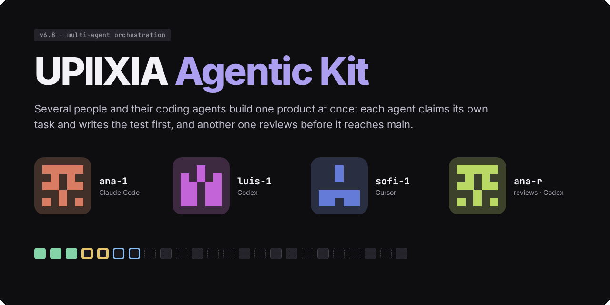
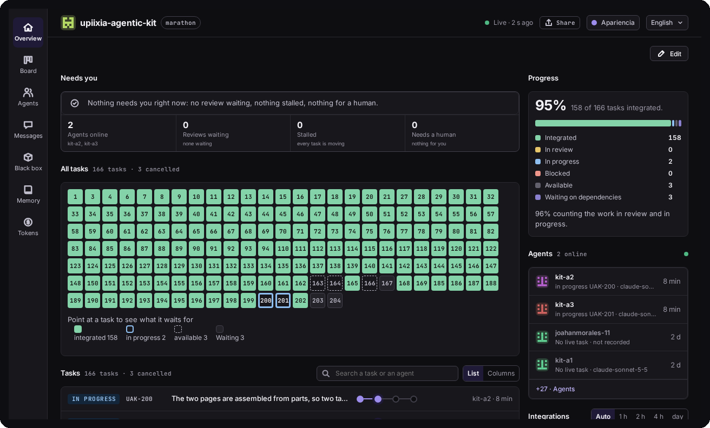
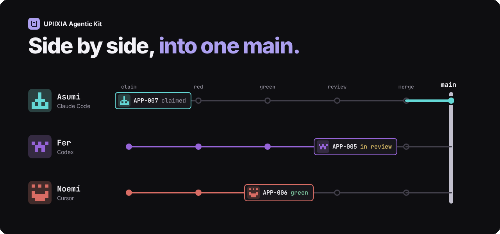

<p align="center"></p>

# UPIIXIA Agentic Kit

**The harness for multi-agent teams.** It runs no model of its own: it coordinates the coding tools you already use, such as Claude Code, Codex and Cursor.

**The aim:** several people and their coding agents working on one repository at the same time, without stepping on each other. No chaos.

[](https://github.com/JoahanMorales/upiixia-agentic-kit/actions/workflows/test.yml)


[](https://m8ven.ai/mcp/joahanmorales-upiixia-agentic-kit-1e9007?s=readme)

**What it is.** A set of Bash scripts and written rules that lets several AI coding agents work in one Git repository at the same time, each on its own task, with every change tested and reviewed before it reaches the main branch.

**Who it is for.** Anyone who runs more than one coding agent (Claude Code, Codex, Cursor or Gemini CLI) on the same repository: one person with three agents, or a team of five on five laptops, at a hackathon with a deadline or on a product with users.

**What you have after ten minutes.** The kit installed in your repository, a plan of tasks for your idea that you read and approved, and the exact command that puts your first agent on its first task. A page in your browser walks you there, then shows the whole team's progress.

**Start.** In the root folder of your Git repository:

```bash
git clone --depth 1 https://github.com/JoahanMorales/upiixia-agentic-kit ~/.uak-kit && bash ~/.uak-kit/install.sh --wizard .
```

## Why it exists

One coding agent in one terminal is easy to follow. Put four people on one repository, each running two or three agents, and the same things break every time. They broke for us at Hack-Nation 2026, where five agents and four people built one product overnight ([the retro](docs/RETRO-hacknation-2026.md)):

- two agents edit the same file and one of them loses;
- an agent runs out of tokens while holding the task everyone else waits for;
- a force-push wipes a teammate's work;
- nobody is sure the merged code was ever run;
- the person in charge turns into a traffic light, approving every merge by hand.

The kit is what we wrote after that weekend, and it has been rewritten after every event since: each rule in it points to the incident that made it ([WHY.md](kit/.uak/docs/WHY.md)). What it does today:

| What breaks | What the kit does today |
|---|---|
| Two agents edit the same file | Each task lists the files it may change. A claim whose files overlap a live claim is refused, and the merge refuses a change outside the task's files. |
| An agent stops halfway | A claim has a lease that the agent's hooks renew. When it runs out, another agent takes the task over from the summary the first one left. |
| An agent loops on a failing test | `uak loop` stops after `--max` tries, on the same failure twice, or when the agent edits the test. |
| A force-push, `sudo`, reading `.env` | Hooks in Claude Code, Codex, Cursor and Gemini CLI block them, also inside `cd x && ...`. |
| An API key pasted into the chat | In Claude Code a hook blocks the message before the model reads it. |
| "Did anyone run it" | The reviewer is never the author and runs the task's check on the exact commit it approves. |
| A person merges every pull request | In `sprint` mode the merge gate merges an approved task after running the checks again; shared files (CI, lock files, the kit's engine) still go to a person. |

Where it is going: adding one more agent, or one more teammate, should cost the team nothing but the work itself. It is not there yet. Every command is a round trip to the Git remote, so it takes seconds, and in this repository most merges still wait for a person because they touch the kit's own engine; `docs/EVIDENCE.md` has the counts.

## See it run

<picture><source srcset="docs/media/parallel-loop.webp" type="image/webp"></picture>

Each square is a task. Agents take the ones whose files nobody else holds, another agent reviews the result, and the square turns green when it merges. To watch the real thing, with no install, no AI and no key:

```bash
git clone --depth 1 https://github.com/JoahanMorales/upiixia-agentic-kit && bash upiixia-agentic-kit/kit/.uak/bin/uak demo
```

Three scripted agents share a temporary repository with a local remote. Two claims go through, a third is refused because its files overlap, a test fails before the code exists, a bounded fix loop makes it pass, another agent reviews that exact commit, the gate merges it, and a task that was waiting on it opens by itself.


While agents work, a person follows them on one local page drawn from the `claims` branch:



A click on a task tells its whole story:


There is also a [74-second video](kit/.uak/media/tutorial.mp4) (UAK-199): a demonstration, with drawn screens of the setup page and the dashboard, from an empty project to a deployed app, with [English](kit/.uak/media/tutorial-en.vtt) and [Spanish](kit/.uak/media/tutorial-es.vtt) captions.

## Get started

You need Git, Bash 3.2 or newer (Git Bash on Windows) and, for the setup page, Python 3.8 or newer. Installing needs no account, no API key and no server; writing the plan from the page uses Claude Code or Codex, signed in.

**With the setup page** (a person at a computer): the command under **Start.** above. It opens a local page that detects your project, installs the kit, publishes it to `main`, writes the plan with you and ends with one button per agent. If `~/.uak-kit` already exists, run `git -C ~/.uak-kit pull` and then the part after `&&`.

**From a terminal** (no browser, CI, or an agent installing the kit):

```bash
git clone --depth 1 https://github.com/JoahanMorales/upiixia-agentic-kit ~/.uak-kit
bash ~/.uak-kit/install.sh --mode sprint .
bash .uak/bin/uak start
```

Write `--mode marathon` instead for a product. `uak start` checks each step from install to the first claim in order, gives the fix for the first one missing, and ends with the exact command that starts the first task. The installer never overwrites a file of yours: when one differs, the kit's version is written beside it as `.uak-new`. Other options (a stack preset, which coding tools, `--solo` when you are the only person on the repository) are listed in `docs/REFERENCE.md`.

**As a Claude Code plugin:** `/plugin marketplace add JoahanMorales/upiixia-agentic-kit`, then `/plugin install uak@upiixia-agentic-kit`, then `/uak:setup`.

**Claude Code in a new folder:** run `claude` once in the repository and accept the trust question. Until then Claude Code ignores the repository's `.claude/settings.json` ("this workspace has not been trusted"), and an agent started without a window stops at its first command. Each task's folder asks once too.

Every agent starts its session with:

```bash
bash .uak/bin/uak next
```

and a person follows the work with:

```bash
bash .uak/bin/uak dash --watch --open
```

## How it works

Everything lives in your repository. The plan is `.uak/TASKS.md`, the project's rules are `.uak/PROJECT.md`, and the live state (who works on what, reviews, messages) is a series of commits on a branch named `claims` on your Git remote. There is no server: each command reads and writes that branch, so it works the same from one laptop or from five, with any mix of coding tools.

1. **Plan.** Each task has an ID, the files it may change (`Paths`), the tests that show it works (`Tests`), the command that checks it (`Verify`) and the tasks it waits for. An agent drafts the plan with `/uak-plan`; a person approves it.
2. **Claim.** `wt new HACK-001` gives the task its own branch and folder (a Git worktree) and records the claim on `claims`.
3. **Test first.** The agent writes the task's tests, `uak red` records that they fail, then it writes the code. `uak done` refuses a change that edits or deletes an existing test.
4. **Review.** `uak done` asks one reviewer, picked by rotation and never the author, who runs `Verify` on the exact commit and approves or rejects that commit.
5. **Merge.** `uak merge` merges the approved commit, runs the checks again on the result and pushes `main` and `claims` together.
6. **Next.** `uak next` tells each agent what to do now, and when there is nothing, why. `uak board` prints the team in a terminal; `uak dash` draws it as a page.



You choose one of two modes at install. `sprint` is for a deadline: an agent merges after the review, and new work stops at a freeze before the end. `marathon` is for a product with users: a person merges every pull request, with specs and security reviews. The walkthroughs are in `docs/GUIDE.md`.

## What it has won

Teams using the kit took first place at these four events, with the kit running in the entry's repository. Each event's data then became a release of the kit.

| Event | Date | Place | Entry | Kit | Source |
|---|---|---|---|---|---|
| OpenAI × Kavak hackathon | 2026-11-09 | first place | AXIA (repository not public) | v6.0.0 | [CHANGELOG, v6.1.0](CHANGELOG.md), and the maintainer's statement of 2026-11-25 in `docs/EVIDENCE.md` |
| HackADA | 2026-10-29 | first place | [colonIA](https://github.com/rvvictor/HackADA-Upiixia) | v5.3.0 | [CHANGELOG, v5.9.0](CHANGELOG.md) |
| Chilangatón | 2026-10-25 | first place | [colonIA](https://github.com/rvvictor/Chilangaton-Upiixia) | v5.3.0 | [CHANGELOG, v5.4.0](CHANGELOG.md) |
| ISAC × Diablos Rojos, sports analytics | 2026-10-12 to 2026-10-22 | first place | [Stuff+ 2240](https://github.com/JoahanMorales/stuffplus2240) | v4.2.1, then v5.0.0 | [the maintainer's profile](https://github.com/JoahanMorales), read 2026-11-25 |

Each public entry has the kit in its own repository (`.uak/VERSION`). The black box and autopsy of every event are in `docs/blackbox/`.

## How it compares

Other tools solve parts of this, and several do those parts better. Each row is what that tool's own documentation says, read on the date shown.

| Tool | What it is, in its own docs | How its agents share the work | Where it does more than this kit | Source, checked |
|---|---|---|---|---|
| Claude Code agent teams | Several Claude Code instances as a team, with a lead; experimental and off by default | A shared task list with file locking on claims, and a mailbox; stored locally, one team per session, Claude Code only | Built into Claude Code: the lead starts its teammates itself and they message each other live | [code.claude.com](https://code.claude.com/docs/en/agent-teams), 2026-11-25 |
| Claude Squad | A terminal app to manage several agents (Claude Code, Codex, Gemini, Aider and others); AGPL-3.0 | One tmux session and one Git worktree per agent, in one terminal window | A terminal interface to watch and switch between many agent sessions | [github.com/smtg-ai/claude-squad](https://github.com/smtg-ai/claude-squad), 2026-11-25 |
| Conductor | A Mac app that runs Claude Code, Codex and Cursor agents in isolated workspaces | One Git worktree and branch per workspace, on your Mac | A native app with a diff viewer, pull requests and a panel of CI checks | [conductor.build/docs](https://www.conductor.build/docs/), 2026-11-25 |
| Vibe Kanban | A kanban board for coding agents; its README says it is sunsetting; Apache-2.0 | Issues on a board; each workspace gets a branch, a terminal and a dev server | A web board with inline comments on diffs, and a self-hosted instance a team can share | [github.com/BloopAI/vibe-kanban](https://github.com/BloopAI/vibe-kanban), 2026-11-25 |
| MCP Agent Mail | A mail-like coordination layer for coding agents, as an MCP server; deprecated in favour of a Rust version | Inboxes, threads and advisory file reservations, with an optional pre-commit guard | Searchable message threads and a web page for people to read them | [github.com/Dicklesworthstone/mcp_agent_mail](https://github.com/Dicklesworthstone/mcp_agent_mail), 2026-11-25 |
| Beads | A distributed graph issue tracker for AI agents, on Dolt; it moved to gastownhall/beads | Issues with dependencies; a claim is atomic, and ready work is what has no open blocker; it syncs through the Git remote | A versioned issue database with dependency queries | [github.com/gastownhall/beads](https://github.com/gastownhall/beads), 2026-11-25 |
| GitHub Spec Kit | A toolkit that gives coding agents structured processes and templates, from spec to implementation | One agent walks constitution, spec, plan, tasks and implementation, a person reviewing each step | A spec-driven workflow with templates, extensions and integrations for many coding agents | [github.com/github/spec-kit](https://github.com/github/spec-kit), 2026-11-25 |
| BMAD Method | An AI-driven agile method, from an idea to working software | Skills and planning documents (requirements, epics); its build skill includes a review stage | A full planning method with product, architecture, design and test roles | [github.com/bmad-code-org/BMAD-METHOD](https://github.com/bmad-code-org/BMAD-METHOD), 2026-11-25 |
| Task Master | A task-management system for AI agents inside the editor; MIT with Commons Clause | Tasks and subtasks with dependencies, generated from a product document; it shows the next task | Turns a product document into a task list with a model, and runs as an MCP server in the editor | [github.com/eyaltoledano/claude-task-master](https://github.com/eyaltoledano/claude-task-master), 2026-11-25 |

What this kit adds to that list: several people on several machines coordinate through one Git branch, with no server; a claim on overlapping files is refused; the reviewer is another agent that runs the check on the exact commit; and a merge gate runs the checks again before `main` moves. If you work alone on one laptop and want an app to watch your agents' sessions and switch between them, Conductor (on a Mac) or Claude Squad gives you that; this kit does not.

## What it does not do

- It does not start or host the agents. You open each coding tool yourself (`uak up` can open several in tmux); the kit gives them the rules, the commands and the hooks.
- It is not a sandbox. The hooks stop common accidents; for an agent you do not trust, use your coding tool's sandbox as well.
- It does not decide for you: a person approves the plan, and in `marathon` a person merges.
- It needs one Git remote that everyone pushes to. If the repository is public, its `claims` branch is public too, black box included: one-line notes about the kit's own failures, with no names, paths or code, on by default and turned off with `Blackbox: off` in `.uak/PROJECT.md`.
- On Windows it runs in Git Bash, never in WSL's bash.
- It is not fast per command: each command is a round trip to the Git remote and takes seconds.

## Where to read more

- [docs/GUIDE.md](docs/GUIDE.md): walkthroughs. The setup page, a task from claim to merge, working alone, fix loops, the code map, screens, deploying, the black box.
- [docs/REFERENCE.md](docs/REFERENCE.md): lists. Install options, modes, stacks, coding tools, commands, what the install adds.
- [docs/EVIDENCE.md](docs/EVIDENCE.md): what was measured, when and how, the team events and the wins with their proof.
- [docs/DASHBOARD.md](docs/DASHBOARD.md): the setup page and the dashboard in detail.
- [docs/HACKATHON.md](docs/HACKATHON.md): one page for a hackathon.
- [CHANGELOG.md](CHANGELOG.md): what changed in each release.

## For an agent reading this

- To install the kit in a repository, follow [skills/setup/SKILL.md](skills/setup/SKILL.md) or run the three commands under "From a terminal". The setup page (`--wizard`) is for a person and refuses to start for an agent.
- [AGENTS.md](kit/AGENTS.md) has the rules every agent follows; a project has it at its root.
- [CLI.md](kit/.uak/docs/CLI.md) has every command and its options; a project has it at `.uak/docs/CLI.md`.
- [WHY.md](kit/.uak/docs/WHY.md) has the reason (an incident or a measurement) behind each rule; a project has it at `.uak/docs/WHY.md`.
- Start every session with `bash .uak/bin/uak next` and do what its `Next:` line says.
- To change the kit itself, read [the repository's own AGENTS.md](AGENTS.md).

## Contributing

Pull requests are welcome: stack presets, checks for loops and the task graph, and the black box or retro of your own event. Read [CONTRIBUTING.md](CONTRIBUTING.md) first. Every new rule cites its incident or measurement in `kit/.uak/docs/WHY.md`, and every change to the engine comes with a test that fails without it. The kit is developed with itself: its tasks and their state are on this repository's `claims` branch.

## License

MIT, Joahan Morales and contributors ([LICENSE](LICENSE)). Skills taken from other projects keep their own licenses ([SOURCES](kit/.uak/skills/SOURCES.md)).
