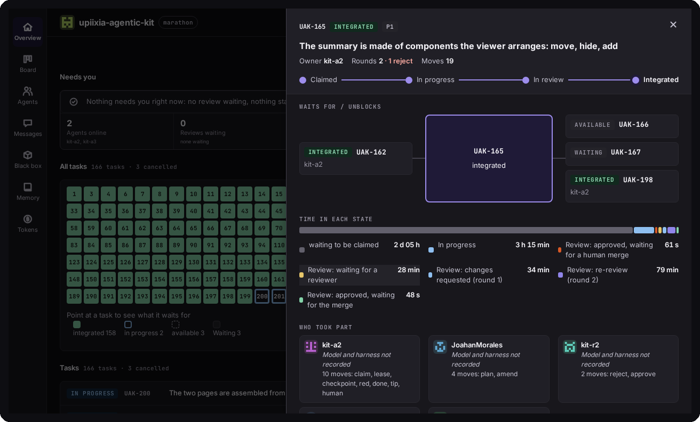

# UPIIXIA Agentic Kit

**What it is.** A set of Bash scripts and written rules that lets several AI coding agents work in one Git repository at the same time, each on its own task, with every change tested and reviewed before it reaches the main branch.

**Who it is for.** People who run more than one coding agent (Claude Code, Codex, Cursor or Gemini CLI) on the same repository, alone or as a team on several machines, at a hackathon or on a product with users.

**What you have after ten minutes.** The kit installed in your repository, a list of tasks for your idea that you read and approved, and the exact command that puts the first agent on the first task. A page in your browser takes you through these steps and then shows the team's progress.

**Start.** In the root folder of your Git repository:

```bash
git clone --depth 1 https://github.com/JoahanMorales/upiixia-agentic-kit ~/.uak-kit && bash ~/.uak-kit/install.sh --wizard .
```

You need Git, Bash 3.2 or newer (Git Bash on Windows) and Python 3.8 or newer for the page. Installing needs no account, no API key and no server; writing the plan from the page uses Claude Code or Codex, signed in. If `~/.uak-kit` already exists, run `git -C ~/.uak-kit pull` and then the part after `&&`.

## How it works

Everything lives in your repository. The plan is `.uak/TASKS.md`, the project's rules are `.uak/PROJECT.md`, and the live state (who works on what, reviews, messages) is a series of commits on a branch named `claims` on your Git remote. There is no server: each command reads and writes that branch.

1. **Plan.** Each task has an ID, the files it may change (`Paths`), the tests that show it works (`Tests`), the command that checks it (`Verify`) and the tasks it waits for. An agent drafts the plan with `/uak-plan`; a person approves it.
2. **Claim.** `wt new HACK-001` gives the task its own branch and folder (a Git worktree) and records the claim on `claims`. A task whose `Paths` overlap those of a claimed task cannot be claimed, so no file belongs to two live tasks, and the merge refuses a change to a file outside the task's `Paths`. A claim has a lease that the agent's hooks renew; when it runs out, another agent can take the task over from the summary the first one left.
3. **Test first.** The agent writes the task's tests, `uak red` records that they fail, and then it writes the code. `uak done` refuses a change that edits or deletes an existing test.
4. **Review.** `uak done` asks one reviewer, picked by rotation and never the author, who runs `Verify` on the exact commit and approves or rejects that commit.
5. **Merge.** `uak merge` merges the approved commit, runs the checks again on the result and pushes `main` and `claims` together. A change to shared files (CI, lock files, the kit's own engine) goes to a person instead.
6. **Follow.** `uak next` tells each agent what to do now, and when there is nothing, why. `uak dash` draws a local page from the `claims` branch; `uak board` prints the same in a terminal.

Hooks in Claude Code, Codex, Cursor and Gemini CLI block force-pushes, `sudo` and reading `.env`; in Claude Code they also block secrets pasted into the chat. You choose one of two modes at install: `sprint` for a deadline (an agent merges after the review, new work stops at a freeze before the end) or `marathon` for a product (a person merges every pull request, with specs and security reviews).




## Try it without installing

```bash
git clone --depth 1 https://github.com/JoahanMorales/upiixia-agentic-kit && bash upiixia-agentic-kit/kit/.uak/bin/uak demo
```

Three scripted agents work in a temporary repository with a local remote, with no AI and no key: two claims, a third refused because its files overlap, a test that fails before the code, a bounded fix loop, a review by an agent that is not the author, a merge, and a dependent task that opens after it. There is also a [simulated video walkthrough](kit/.uak/media/tutorial.mp4), from an empty project to a deployed app, with [English](kit/.uak/media/tutorial-en.vtt) and [Spanish](kit/.uak/media/tutorial-es.vtt) captions.



## Start from a terminal

Use this without a browser, in CI, or when an agent installs the kit:

```bash
git clone --depth 1 https://github.com/JoahanMorales/upiixia-agentic-kit ~/.uak-kit
bash ~/.uak-kit/install.sh --mode sprint .
bash .uak/bin/uak start
```

Write `--mode marathon` instead for a product. `uak start` checks each step from install to the first claim in order, gives the fix for the first one missing, and ends with the exact command that starts the first task. The installer never overwrites a file of yours: when one differs, the kit's version is written beside it as `.uak-new`. The other options (a stack preset, which coding tools, `--solo` when you are the only person on the repository) are listed in `docs/REFERENCE.md`.

In Claude Code you can install it as a plugin instead: `/plugin marketplace add JoahanMorales/upiixia-agentic-kit`, then `/plugin install uak@upiixia-agentic-kit`, then `/uak:setup`.

**Claude Code in a new folder:** run `claude` once in the repository and accept the trust question. Until then Claude Code ignores the repository's `.claude/settings.json` ("this workspace has not been trusted"), and an agent started without a window stops at its first command. Each task's folder asks once too.

Every agent starts its session with:

```bash
bash .uak/bin/uak next
```

and a person follows the work with:

```bash
bash .uak/bin/uak dash --watch --open
```

## What it does not do

- It does not start or host the agents. You open each coding tool yourself (`uak up` can open several in tmux); the kit gives them the rules, the commands and the hooks.
- It is not a sandbox. The hooks stop common accidents; for an agent you do not trust, use your coding tool's sandbox as well.
- It does not decide for you: a person approves the plan, and in `marathon` a person merges.
- It needs one Git remote that everyone pushes to. If the repository is public, its `claims` branch is public too, black box included: one-line notes about the kit's own failures, with no names, paths or code, on by default and turned off with `Blackbox: off` in `.uak/PROJECT.md`.
- On Windows it runs in Git Bash, never in WSL's bash.
- Each command is a round trip to the Git remote, so it takes seconds, not milliseconds. In this repository most tasks that reached the merge queue still went to a person, because they touched shared files. The measured times and counts, with how to measure them again, are in `docs/EVIDENCE.md`.

## Where to read more

- [docs/GUIDE.md](docs/GUIDE.md): walkthroughs. The setup page, a task from claim to merge, working alone, fix loops, the code map, screens, deploying, the black box.
- [docs/REFERENCE.md](docs/REFERENCE.md): lists. Install options, modes, stacks, coding tools, commands, what the install adds.
- [docs/EVIDENCE.md](docs/EVIDENCE.md): what was measured, when and how, and the team events behind the rules.
- [docs/DASHBOARD.md](docs/DASHBOARD.md): the setup page and the dashboard in detail.
- [docs/HACKATHON.md](docs/HACKATHON.md): one page for a hackathon.
- [CHANGELOG.md](CHANGELOG.md): what changed in each release.

## For an agent reading this

- To install the kit in a repository, follow [skills/setup/SKILL.md](skills/setup/SKILL.md) or run the three commands of "Start from a terminal". The setup page (`--wizard`) is for a person and refuses to start for an agent.
- [AGENTS.md](kit/AGENTS.md) has the rules every agent follows; a project has it at its root.
- [CLI.md](kit/.uak/docs/CLI.md) has every command and its options; a project has it at `.uak/docs/CLI.md`.
- [WHY.md](kit/.uak/docs/WHY.md) has the reason (an incident or a measurement) behind each rule; a project has it at `.uak/docs/WHY.md`.
- Start every session with `bash .uak/bin/uak next` and do what its `Next:` line says.
- To change the kit itself, read [the repository's own AGENTS.md](AGENTS.md).

## Contributing

Read [CONTRIBUTING.md](CONTRIBUTING.md). Every new rule cites its incident or measurement in `kit/.uak/docs/WHY.md`, and every change to the engine comes with a test that fails without it. The kit is developed with itself: its tasks and their state are on this repository's `claims` branch.

## License

MIT, Joahan Morales and contributors ([LICENSE](LICENSE)). Skills taken from other projects keep their own licenses ([SOURCES](kit/.uak/skills/SOURCES.md)).
